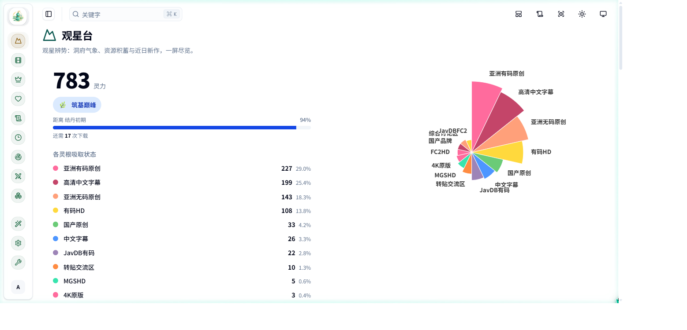
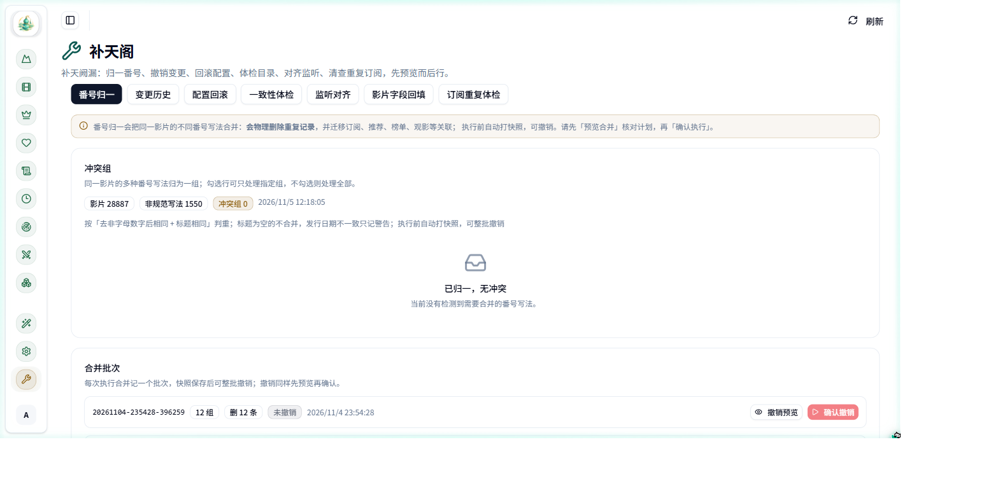
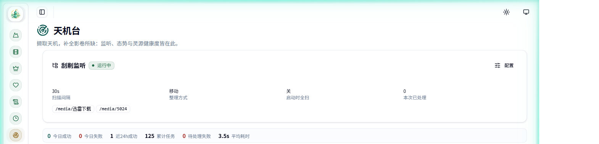

# immortal

> 影视元数据 / 订阅 / 刮削管理面板。Docker 一键部署，前端已内置，无需编译。
>
> 维护者：**子不轻言** · 当前版本 **2.3.0**
>
> Docker Hub：**[zibuqingyan/immortal](https://hub.docker.com/r/zibuqingyan/immortal)**
> [](https://hub.docker.com/r/zibuqingyan/immortal)
> [](https://hub.docker.com/r/zibuqingyan/immortal/tags)
> [](https://hub.docker.com/r/zibuqingyan/immortal/tags)

---

| 观星台 · 库存与来源分布 | 补天阁 · 番号归一与整批撤销 |
|---|---|
|  |  |



> 截图使用「模糊图片」模式：海报与封面不显示，只看功能与数据。

---

## 这是什么

immortal 不负责播放，负责「片子进库之前和之后的所有麻烦事」：

- 从多个站点抓取番号、标题、简介、演员、海报、背景图
- 把元数据写成 Emby / Jellyfin / Plex 能识别的 `.nfo` 与图片（按 2:3 裁切、与视频同名）
- 按规则自动订阅新片、自动下载、自动整理归档（移动 / 硬链接 / 软链接）
- 把媒体库情况与观影习惯统计成图表，一键生成可分享的观影海报

界面支持**仙侠 / 通俗双命名**，一键切换全站文案。

首次启动有**七步配置向导**（媒体目录 / 媒体服务器 / 下载器 / 通知渠道 / 网络与代理 / 抓取源 / 连通自检），媒体服务器支持 Emby、Jellyfin、Plex、极影视四选一，下载器四种任选，通知三渠道任选；每一步都能跳过、配置随时可改，配置不全时观星台会显示引导条。

## 下载

> **架构说明**：2.3.0 目前只提供 **amd64** 镜像（群晖 / 威联通 / 极空间等 x86 机型，以及绝大多数家用 NAS 与服务器）。arm64 机型可继续使用 [2.1.6](https://hub.docker.com/r/zibuqingyan/immortal/tags)，功能差异见下方「版本」表。
>
> 2.3.0 **已发布**，并把此前只在本地构建的 2.2.3～2.2.9 一并带上（JavDB 撞限流自动冷却重试、通知多轮重试、监听目录可单独移除）。

### 方式一：直接拉镜像（推荐）

```bash
docker pull zibuqingyan/immortal:2.3.0
```

然后 `deploy/docker-compose.yml` 里把 `image:` 改成 `zibuqingyan/immortal:2.3.0`，或本地打 tag：

```bash
docker tag zibuqingyan/immortal:2.3.0 immortal:2.3.0
```

### 方式二：离线包

到 [Releases](../../releases) 取对应版本的 `*-compose.zip`（compose + 文档 + 截图）、`*-image.tar.gz`（amd64 镜像）或 `*-compose.tar.gz`（只要 compose 与文档）。

## 三步启动

```bash
docker pull zibuqingyan/immortal:2.3.0
#   或： gunzip -c immortal-2.3.0-image.tar.gz | docker load
cp .env.example .env && vi .env   # 改 MEDIA_DIR 与 POSTGRES_PASSWORD
docker compose up -d && docker compose ps
```

浏览器打开 `http://<IP>:8000/sign-up` 注册第一个账号，按引导条完成首次配置。完整步骤见 **[WIKI.md](WIKI.md)**。

## 能力一览

| 模块 | 能力 |
|---|---|
| 刮削 | 目录监听 / 批量任务 / 手动补刮；多源并发 + 字段级融合 |
| 元数据 | NFO 生成、海报竖版裁切、演员资料补全与同步回 Emby |
| 订阅 | 影片 / 演员 / 综合订阅；过滤器 + 优先级 + 偏好三层规则 |
| 下载 | qBittorrent / Transmission / CloudDrive / 迅雷 |
| 整理 | 目录浏览、扫描识别番号、空目录清理（先出计划再执行） |
| 统计 | Emby 观影统计、排行、观影海报生成 |
| 运维 | 定时任务（cron）+ 执行日志 + API Token + 三渠道通知 |
| 配置 | 七步首次配置向导（四类媒体服务器 / 四种下载器 / 三种通知渠道）、连通自检 |
| 可观测 | 数据源健康度（成功 / 请求失败 / 解析失败 / 真空未命中 / 不可用）、数据覆盖率 |

## 环境要求

| 项目 | 要求 |
|---|---|
| Docker | 20.10+ |
| Docker Compose | v2 |
| 磁盘 | 约 3 GB |
| 内存 | 512 MB 起步，1 GB 更稳 |

## 常见问题

**Q：刮削全是「未命中」**
多数是出网问题。在 `.env` 里配 `SCRAPE_PROXY` 指向自己的代理后重启。天机台「灵源健康度」会区分请求失败、解析失败与真空未命中，先看清是哪一类。

**Q：NFO 生成了但 Emby 不认**
NFO 必须与视频同名（`ABC-123.mp4` ↔ `ABC-123.nfo`）。

**Q：改了数据库密码就连不上**
密码只在 `pgdata` 首次初始化时写入，要么改回去，要么清库重来（会丢数据）。

**Q：从 2.0.0 升级要注意什么**
2.0.1 起 JWT 密钥改为随机持久化，升级后**所有登录态与旧 API Token 失效，重新登录一次即可**；数据在 `/data` 卷内不受影响。

## 声明

本项目仅供个人自建媒体库的元数据管理使用，不提供、不托管、不分发任何音视频内容。

## 版本

| 版本 | 要点 |
|---|---|
| 2.3.0 | **目录不再锁在 /media、AV 库不再写死库名**：媒体挂载点与库名都因服务器而异，这版把「必须在 /media 下」的路径校验整条去掉，扫描 / 整理 / 空目录清理按实际路径工作；新增设置「媒体库」，从服务器真实库列表勾选 AV 库与观影统计库，留空则自动识别。群芳谱演员数、盈虚鉴统计范围、NFO 演员补全扫描根、整理目标目录默认值、补天阁默认扫描目录一并改为按所选库解析；整理目标目录留空即自动取 AV 库目录 |
| 2.2.9 | **修「删掉的监听目录又回来」**：改监听配置时只写了库，正在运行的监听器没重启，仍按旧目录工作，界面轮询把旧目录读回来；现在先停再起并等旧线程退出，顺带避免两个监听器重复刮同一部片 |
| 2.2.8 | **刮削监听支持单独移除目录**：每个目录后带 ×，点一下即从监听列表移除；展开「配置」自动回填当前目录，改动标黄提示，点「应用并重启」生效。此前目录只能整组重填、列表还是只读的 |
| 2.2.7 | **JavDB 请求间隔自适应**：撞一次限流就放宽一半、连续 20 次顺利再慢慢收回。实测同一出口 IP 间隔 1.8 秒第 20 条被掐、3.9 秒第 11 条也被掐，站点按滚动窗口记分，固定间隔治不了 |
| 2.2.6 | **磁力爬虫不再把出口 IP 打成限流**：模块内统一按 3～4.5 秒一条发请求（原来调度器只隔 1 秒，实测连续 19 条就被站点掐断连接）；详情请求超时由 60 秒收紧到 25 秒，撞限流后的冷却时间不再被自己的超时吃掉 |
| 2.2.5 | **通知不再因出口抖动整条丢失**：Telegram 发送由「每条线路试一次」改为 0 / 5 / 12 秒三轮重试，代理换节点那十几秒的空窗能自动熬过去；连续失败的线路压制 10 分钟不再反复白等超时（国内直连 api.telegram.org 本就不通）；token 失效、chat_id 不对、bot 被拉黑等配置错直接停止重试并写明怎么修，不再只留一句「所有出网线路均不可用」 |
| 2.2.4 | 冷却补上止步条件：累计冷却 120 + 240 + 480 秒仍未恢复就结束本轮并写明原因，不再把任务拖成「跑一整天也没进展」 |
| 2.2.3 | **JavDB 抓取不再因一次连接被掐就整轮失败**：撞上反爬限流自动冷却 2 / 4 / 8 分钟重试，连续三轮探测都失败才报错；收藏同步、订阅补抓、磁力爬虫统一按 3 秒一条限速；列表页与详情页的 SSL 错误改为冷却重试，不再当成「这个条目没磁力」跳过；错误信息分清「出口被限流（等几分钟或换节点）」与「地区封锁（必须换地区）」 |
| 2.2.2 | **修复 JavDB 抓取中断**：查清是 v2raya 的「最小延迟」策略把出口长期钉在日本节点，而日本被站点按地区封锁；已把日本节点移出出网池，出口改由新加坡 / 香港 / 美国等可用地区承担。**反爬限流与地区封锁分开处理**：403 改为退避重试并自动拉长请求间隔，只有版权限制页才判定出口不可用，不再一条 403 就让整轮任务作废；订阅补抓基础间隔由 1.5 秒放宽到 3 秒，受限时逐步后撤、恢复后收回。实测订阅补抓由 15 条全未命中恢复为 15 条全命中、入库 7 条 |
| 2.2.1 | **抓取零产出主动告警**：连续 3 次抓不到内容就推一条通知，不再因为任务「没报错」而让整天 0 入库悄悄过去；「没活可干」（没有待补番号）不算零产出，不打扰人；JavDB 出口被封锁时立刻失败并写明原因，不再空跑几千次请求、每条影片重登一次；通知发送支持多线路兜底（配置代理 → 抓取代理 → 直连）；任务日志区分「成功 / 失败 / 本次无产出」 |
| 2.2.0 | 手机端逐页梳理：验证码不再横向溢出、底部导航统一留安全区、长表格改卡片布局、小按钮触控热区补到 40px；双命名收敛，通俗模式下不再漏出仙侠词，页面标题、说明与图标统一从导航配置取；配色集中由主题变量提供，亮暗主题自动切换；文案与空态说清原因与下一步；新增前端 UI 守卫并接入发版门禁 |
| 2.1.6 | 补天阁新增「多版本择优」：自定义优先级规则序列、按视频库限定扫描、按建议一键清理（永久删除，逐组二次确认）、同目录分组判据修正；手机端结果改卡片布局、排序规则默认折叠；后端启动内存优化（pandas 延迟导入、机器人按配置懒加载），空闲常驻内存降低约 21% |
| 2.1.5 | 恢复「版本更新检查」：每天 09:00 对比 GitHub Releases 与 Docker Hub，发现比当前运行版本更新的版本时推送到已启用的通知渠道，同一版本只推一次；「版本印记」显示可升级版本、发布时间、升级命令与当次更新说明，可手动重新检查，并内置近六个版本的更新记录（离线可读）；修正「启用 AI 能力」开关的说明——它是总开关，关闭会同时停用机器人对话与演员简介翻译；页面标题图标统一从导航配置取，此前盈虚鉴、启程引、浮光阁三页标题前是空的 |
| 2.1.4 | 引导补齐「媒体服务器」四选一（Emby / Jellyfin / Plex / 极影视，各带专属凭据字段）与「通知渠道」步骤（企业微信 / Telegram / Discord），共七步；抓取源可在向导内直接启用/停用，不必再跳去灵源谱；连通自检新增通知渠道项，并逐个探测已配置的媒体服务器与全部下载器（4xx 标注「需鉴权，属正常」不再误报）；侧边栏「仙府内务」补上「盈虚鉴」（数据覆盖率）入口；维护中心新增「订阅重复体检」，只读列出被多路订阅重复覆盖的影片与条件重复的综合订阅 |
| 2.1.3 | 首次配置向导补齐下载器：qBittorrent / Transmission / CloudDrive / 迅雷 四种可选，每种都带保存目录；媒体目录步骤新增「监听目录」，保存即重启监听，打通「下载 → 自动刮削」；侧边栏「仙府内务」直接挂上维护中心（补天阁）入口 |
| 2.1.2 | **维护中心**页面上线（补天阁：番号归一 / 变更撤销 / 配置回滚 / 只读体检 / 监听对齐 / 字段回填）；番号冲突自动合并（标题+等价番号判重，执行前快照、可整批撤销）；写入路径按等价番号查重，阻断新重复；文件变更日志与批量撤销；配置历史与逐版回滚；刮削成功后 Emby 单条目刷新；字段冲突留痕；影片字段回填任务；卡死任务回收与自动重试 |
| 2.0.2 | 六步首次配置向导 + 连通自检；数据源失败归因（四态健康度 / 单源自测）；数据覆盖率可视化与一键回填；PWA 冷启缓存防回归；CORS 默认同源 |
| 2.0.1 | 安全加固：JWT 密钥随机持久化、登录态默认过期、敏感接口鉴权；天机台补「硬链接」选项 |
| 2.0.0 | 双命名全站贯通、版本页加维护者、镜像去掉私有内网默认值 |
